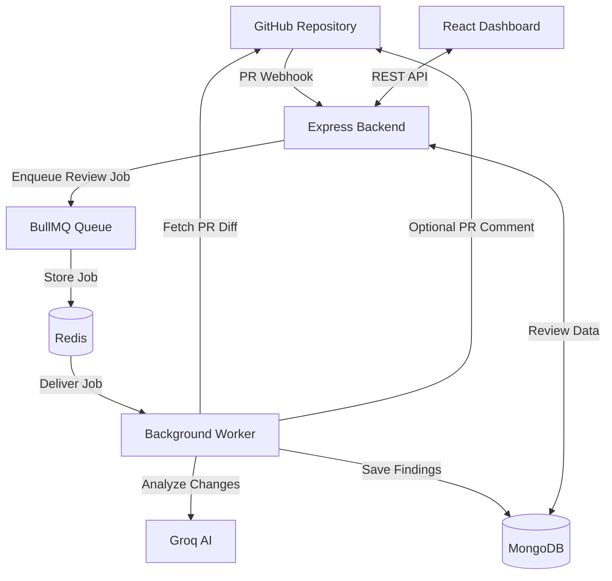
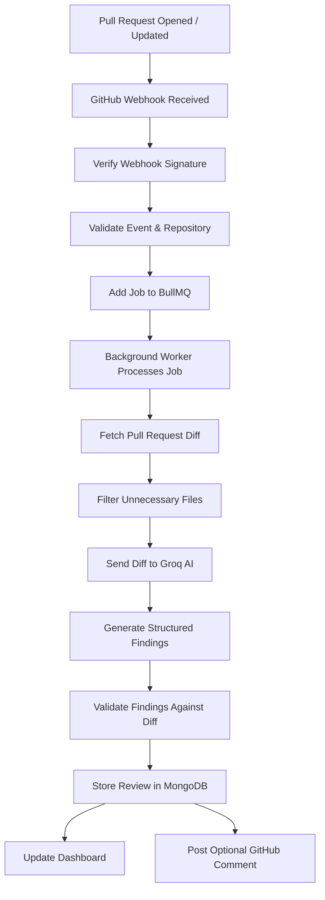

# CodeGuard

**AI-Powered GitHub Pull Request Code Review**

CodeGuard is an automated code review platform that analyzes GitHub Pull Requests using AI. It processes code changes asynchronously, identifies potential issues, validates findings against actual diff lines, and presents actionable feedback through a centralized dashboard.

## Key Features

- **Automated PR Reviews** – Trigger code reviews whenever a Pull Request is opened or updated.
- **AI-Powered Analysis** – Uses Groq to identify potential bugs, code quality issues, and improvements.
- **Asynchronous Processing** – BullMQ and Redis handle background review jobs without blocking webhook requests.
- **Finding Validation** – Validates AI-generated findings against actual code changes to reduce unsupported results.
- **GitHub Integration** – GitHub App integration for repository access and automated PR feedback.
- **Review Dashboard** – View review history, findings, severity, and suggested fixes.
- **Retry Mechanism** – Automatically retries failed jobs with exponential backoff.

## Tech Stack

| Category | Technologies |
|---|---|
| Frontend | React 19, Vite, Tailwind CSS |
| Backend | Node.js, Express.js |
| Database | MongoDB, Mongoose |
| Queue | Redis, BullMQ, ioredis |
| AI | Groq API (GPT-OSS-20B) |
| Integration | GitHub OAuth, GitHub App |
| Deployment | Vercel, Render |

## Architecture

CodeGuard follows an event-driven architecture where GitHub webhooks trigger asynchronous code review jobs.



## Pull Request Review Workflow



## Getting Started

### Prerequisites

- Node.js
- MongoDB instance
- Redis instance
- GitHub OAuth App
- GitHub App credentials
- Groq API key

For automated review publishing, configure the GitHub App with **Pull requests: Read and write**. Read access is used to fetch PR diffs and heads; write access is required to publish grouped inline reviews. The App also subscribes to the existing `pull_request`, `installation`, and `installation_repositories` webhook events. After changing permissions, save the App settings and approve the updated permissions for its installation in GitHub before live testing. CodeGuard cannot change these external settings.

### Local development

Requirements: Node.js 22.12 or newer and Docker Desktop. The project includes local Redis and MongoDB containers; the backend and BullMQ worker read the same local connection URLs.

Install dependencies once:

```bash
cd server && npm install
cd ../client && npm install
```

If `server/.env.local` does not exist, create it from the local template:

```bash
cp server/.env.local.example server/.env.local
```

`server/.env.local` contains local-only service URLs and overrides `server/.env` when using the local scripts. Keep provider credentials out of the example file. For local GitHub sign-in and App flows, create local GitHub OAuth/App configurations, then put their credentials and private-key path in the ignored `server/.env.local`. The OAuth callback must be `http://localhost:5000/api/auth/github/callback`; the App callback must match `GITHUB_APP_CALLBACK_URL`. External GitHub settings are not changed by these commands.

Start local MongoDB and Redis:

```bash
docker compose up -d mongodb redis
docker compose ps
```

In separate terminals, start the API and worker:

```bash
cd server
npm run dev
```

```bash
cd server
npm run worker:dev
```

Start the Vite frontend in another terminal:

```bash
cd client
npm run dev
```

Open `http://localhost:5173`. Development API calls are pinned to `http://localhost:5000`, even if a production `VITE_API_BASE_URL` is present in the shell. Check API, MongoDB, and Redis readiness at `http://localhost:5000/healthz`.

Stop the API and worker with **Ctrl+C** in their terminals, then stop the local containers:

```bash
docker compose stop mongodb redis
```

The local database volume is retained. `docker compose down -v` deletes that local volume and its data; use it only if you intend to remove the local database.

### Render backend and worker

The API and review worker have separate entry points. `/healthz` reports ready only when MongoDB and Redis respond and at least one worker for the review queue is connected.

Choose one deployment mode in the Render dashboard:

- **Single Web Service:** use `npm run start:all`. This starts the API and worker as child processes; if either exits unexpectedly, the combined service shuts down with a failure. This is the simplest mode for a demo.
- **Separate services:** configure a Web Service with `npm start` and a Background Worker with `npm run worker`. Set the same `MONGODB_URI`, `REDIS_URL`, `GROQ_API_KEY`, `GITHUB_APP_ID`, and either `GITHUB_APP_PRIVATE_KEY_PATH` or `GITHUB_APP_PRIVATE_KEY` on both services. The API health check remains not ready until the separate worker is connected.

Set the Render service root directory to `server`. Check each service's actual type, root directory, start command, and environment in the Render dashboard; this repository does not include a Render service blueprint.

### Production frontend build

Set `VITE_API_BASE_URL` in the Vercel build environment to the HTTPS backend origin. Production builds reject missing or invalid backend URLs. The development server always targets localhost and does not use that production URL.

## Project Structure

```text
CodeGuard/
├── client/
│   └── src/
│       ├── pages/
│       ├── config/
│       └── utils/
│
├── server/
│   └── src/
│       ├── analyzers/
│       ├── config/
│       ├── controllers/
│       ├── middleware/
│       ├── models/
│       ├── routes/
│       ├── services/
│       ├── workers/
│       ├── server.js
│       └── worker.js
│
├── docker-compose.yml
└── README.md
```

## Engineering Highlights

- Event-driven processing using GitHub webhooks.
- Non-blocking background execution with BullMQ.
- Deterministic job IDs and database uniqueness constraints for duplicate prevention.
- Exponential backoff and retry handling for failed jobs.
- Diff-aware validation of AI-generated findings.

---

**Built to make code reviews smarter, more reliable, and less time-consuming.**
