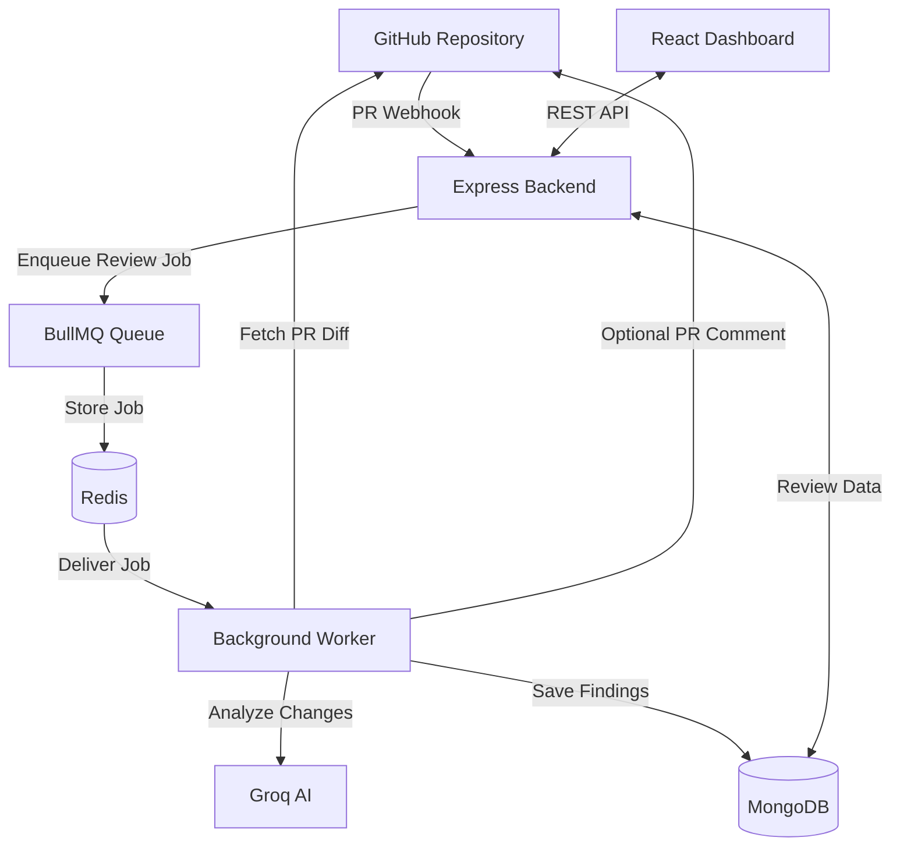
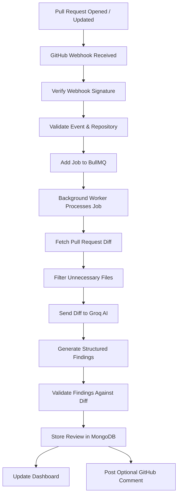

# CodeGuard

**AI-Powered GitHub Pull Request Code Review**

CodeGuard is an automated code review platform that analyzes GitHub Pull Requests using AI. It processes code changes asynchronously, identifies potential issues, validates findings against actual diff lines, and presents actionable feedback through a centralized dashboard.

## Key Features

- **Automated PR Reviews** – Trigger code reviews whenever a Pull Request is opened or updated.
- **AI-Powered Analysis** – Uses Groq to identify potential bugs, code quality issues, and improvements.
- **Asynchronous Processing** – BullMQ and Redis handle background review jobs without blocking webhook requests.
- **Finding Validation** – Validates AI-generated findings against actual code changes to reduce unsupported results.
- **GitHub Integration** – GitHub App integration for repository access and automated PR feedback.
- **Review Dashboard** – View review history, findings, severity, and suggested fixes.
- **Retry Mechanism** – Automatically retries failed jobs with exponential backoff.

## Tech Stack

| Category | Technologies |
|---|---|
| Frontend | React 19, Vite, Tailwind CSS |
| Backend | Node.js, Express.js |
| Database | MongoDB, Mongoose |
| Queue | Redis, BullMQ, ioredis |
| AI | Groq API (GPT-OSS-20B) |
| Integration | GitHub OAuth, GitHub App |
| Deployment | Vercel, Render |

## Architecture

CodeGuard follows an event-driven architecture where GitHub webhooks trigger asynchronous code review jobs.



## Pull Request Review Workflow



## Getting Started

### Prerequisites

- Node.js
- MongoDB instance
- Redis instance
- GitHub OAuth App
- GitHub App credentials
- Groq API key

### 1. Clone the repository

```bash
git clone https://github.com/advitya4169/Codeguard.git
cd CodeGuard
```

### 2. Configure environment variables

Create environment files using the provided examples:

```bash
cp server/.env.example server/.env
cp client/.env.example client/.env
```

Configure the required credentials.

**Backend:** MongoDB, Redis, Groq API, GitHub OAuth, GitHub App, JWT secret, and webhook secret.

**Frontend:** `VITE_API_BASE_URL` pointing to your backend URL.

### 3. Start Redis

```bash
docker compose up -d
```

### 4. Start the backend API

```bash
cd server
npm install
npm start
```

### 5. Start the background worker

Open a separate terminal:

```bash
cd server
npm run worker
```

### 6. Start the frontend

Open another terminal:

```bash
cd client
npm install
npm run dev
```

The application should now be available at `http://localhost:5173`.

## Project Structure

```text
CodeGuard/
├── client/
│   └── src/
│       ├── pages/
│       ├── config/
│       └── utils/
│
├── server/
│   └── src/
│       ├── analyzers/
│       ├── config/
│       ├── controllers/
│       ├── middleware/
│       ├── models/
│       ├── routes/
│       ├── services/
│       ├── workers/
│       ├── server.js
│       └── worker.js
│
├── docker-compose.yml
└── README.md
```

## Engineering Highlights

- Event-driven processing using GitHub webhooks.
- Non-blocking background execution with BullMQ.
- Deterministic job IDs and database uniqueness constraints for duplicate prevention.
- Exponential backoff and retry handling for failed jobs.
- Diff-aware validation of AI-generated findings.

---

**Built to make code reviews smarter, more reliable, and less time-consuming.**
